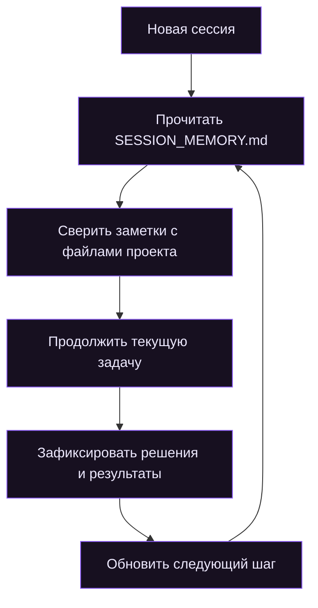

<div align="center">


<p>
  <strong>Память проекта для AI-агентов</strong><br>
  Сохраняйте важный контекст между сессиями и продолжайте работу без повторного погружения.
</p>

<p>
  <a href="#возможности">Возможности</a> &nbsp;·&nbsp;
  <a href="#как-это-работает">Как работает</a> &nbsp;·&nbsp;
  <a href="#установка">Установка</a> &nbsp;·&nbsp;
  <a href="#безопасность">Безопасность</a> &nbsp;·&nbsp;
  <a href="#контакты">Контакты</a>
</p>

<a href="https://agentskills.io/specification"></a>

<a href="https://github.com/Pre11yhacker/memory-upgrade"></a>

</div>

---

## О проекте

**Memory Upgrade** — переносимый навык в формате [Agent Skills](https://agentskills.io/specification), который помогает AI-агентам вести компактную рабочую память проекта в файле `SESSION_MEMORY.md`.

Вместо того чтобы полагаться только на историю чата, агент сохраняет то, что действительно понадобится дальше: текущее состояние проекта, важные решения, ограничения, результаты проверок и ближайший следующий шаг.

При запуске новой сессии память перечитывается и сверяется с реальным состоянием файлов. Это помогает продолжить работу с нужного места, а не восстанавливать контекст с нуля.

> **Идея:** не архивировать весь диалог, а сохранять рабочее состояние проекта — кратко, проверяемо и пригодно для продолжения.

## Возможности

<table>
  <tr>
    <td width="50%">
      <strong>Контекст между сессиями</strong><br>
      <sub>Сохраняет состояние проекта и помогает восстановить ход работы после перезапуска агента.</sub>
    </td>
    <td width="50%">
      <strong>Память по делу</strong><br>
      <sub>Фиксирует решения, ограничения, результаты и незавершённые задачи вместо стенограммы чата.</sub>
    </td>
  </tr>
  <tr>
    <td>
      <strong>Сверка с проектом</strong><br>
      <sub>Заметки проверяются по актуальным файлам, чтобы устаревший контекст не становился источником истины.</sub>
    </td>
    <td>
      <strong>Понятная точка продолжения</strong><br>
      <sub>В памяти остаётся следующий практический шаг, а не только список уже сделанного.</sub>
    </td>
  </tr>
</table>

### Что попадает в память

| Блок | Что содержит |
|---|---|
| Состояние | Цель проекта, текущий статус и ближайший шаг |
| Контекст | Архитектура, требования, важные ограничения |
| Решения | Выбранные подходы и причины выбора |
| Прогресс | Выполненные действия и подтверждённые результаты |
| Открытые вопросы | Блокеры, риски и незавершённые задачи |

## Как это работает

<div align="center">
  <sub>Один файл памяти связывает последовательные рабочие сессии</sub>
</div>



| Этап | Действие агента |
|---|---|
| **01 · Restore** | Читает сохранённую память и проверяет её актуальность |
| **02 · Work** | Выполняет задачу, отмечая важные изменения и решения |
| **03 · Checkpoint** | Обновляет память по ходу работы и перед завершением сессии |
| **04 · Resume** | Следующая сессия начинает с проверенного состояния проекта |

## Установка

### Через GitHub CLI

Установите навык для нужных агентных сред:

```bash
gh skill install Pre11yhacker/memory-upgrade memory-upgrade \
  --agent codex \
  --agent claude-code \
  --agent cursor \
  --agent github-copilot \
  --agent opencode \
  --scope user
```

Уберите параметры `--agent`, которые вам не нужны. Для установки в конкретный проект используйте `--scope project`.

[Документация команды gh skill install](https://cli.github.com/manual/gh_skill_install).

<details>
<summary><strong>Постоянные инструкции проекта</strong></summary>

Для сред, которые загружают `AGENTS.md` как инструкции проекта:

1. Скопируйте [`skills/memory-upgrade/AGENTS.md`](skills/memory-upgrade/AGENTS.md) в корень проекта.
2. Объедините инструкции с существующим `AGENTS.md`, не удаляя текущие правила.
3. Если агент использует другой файл постоянных инструкций, перенесите туда соответствующее правило.

Подробный сценарий работы находится в [`SKILL.md`](skills/memory-upgrade/SKILL.md).

</details>

## Совместимость

Memory Upgrade построен на открытом формате [Agent Skills](https://agentskills.io/specification). Установка и автоматический вызов зависят от возможностей конкретной среды и её конфигурации.

- [OpenAI Codex](https://developers.openai.com/codex/)
- [Claude Code](https://docs.anthropic.com/en/docs/claude-code/overview)
- [Cursor](https://docs.cursor.com/)
- [GitHub Copilot](https://docs.github.com/en/copilot)
- [OpenCode](https://opencode.ai/docs/skills/)

## Безопасность и ограничения

- Не записывайте в память пароли, токены, приватные ключи и другие секреты.
- Разделяйте подтверждённые факты и предположения.
- Сверяйте старые заметки с текущим состоянием проекта.
- Не отмечайте проверки выполненными, если они фактически не запускались.
- Перед публикацией репозитория проверьте `SESSION_MEMORY.md`: в нём может оказаться внутренняя информация.

> [!IMPORTANT]
> **Memory Upgrade не является фоновым сервисом.** Он не наблюдает за неактивными сессиями и не обновляет файлы самостоятельно. Память ведёт активный агент, следуя инструкциям навыка.

## Структура проекта

```text
memory-upgrade/
├── AGENTS.md
├── README.md
├── assets/
│   ├── memory-upgrade-banner.svg
│   └── memory-upgrade-hero.gif
└── skills/
    └── memory-upgrade/
        ├── AGENTS.md
        ├── SKILL.md
        └── templates/
            └── SESSION_MEMORY.md
```

## Участие в проекте

Идеи, сообщения об ошибках и улучшения приветствуются. Для изменений можно открыть [Issue](../../issues) или отправить Pull Request.

Чтобы быстрее разобраться с проблемой, укажите:
- агентную среду и её версию;
- способ установки;
- ожидаемое поведение;
- что произошло фактически.

## Контакты

<div align="center">

**Разработка и обратная связь**

[Telegram · @s1lentpacket](https://t.me/s1lentpacket) &nbsp;·&nbsp; [GitHub · Pre11yhacker](https://github.com/Pre11yhacker)

<sub>Memory Upgrade — Keep project context. Continue with intent.</sub>

</div>
