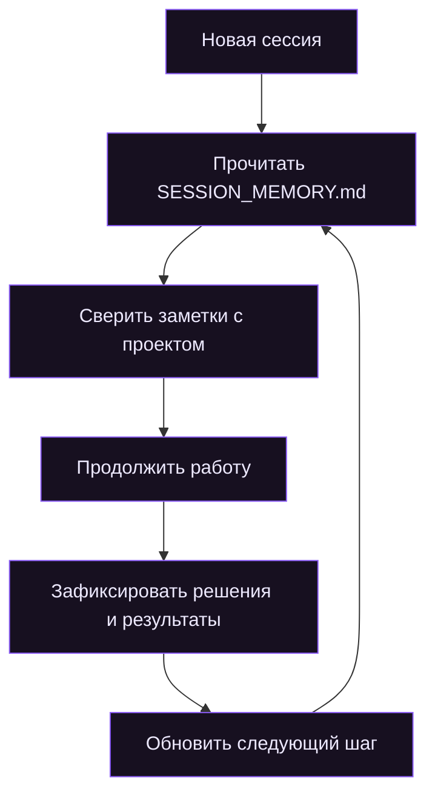

<div align="center">


<br>

### Рабочая память для AI-агентов

Сохраняйте контекст проекта между сессиями. Возвращайтесь к работе с пониманием того, что уже сделано, почему были приняты решения и что делать дальше.

<br>

<br><br>
</a>

</div>

--- 


## О проекте

**Memory Upgrade** — переносимый навык в формате [Agent Skills](https://agentskills.io/specification), который помогает AI-агентам вести компактную рабочую память проекта в файле `SESSION_MEMORY.md`.

Обычная история чата не всегда доступна в новой сессии, а повторное объяснение архитектуры и принятых решений отнимает время. Memory Upgrade решает эту проблему: агент сохраняет важный контекст в отдельном файле, а при следующем запуске читает его и сверяет с реальным состоянием проекта.

> **Основной принцип**  
> Не сохранять весь диалог. Сохранять только то, что помогает продолжить работу: состояние, решения, ограничения, проверенные результаты и следующий шаг.

## Возможности

<table>
  <tr>
    <td width="50%" valign="top">
      <h3>Контекст между сессиями</h3>
      Агент восстанавливает состояние проекта после перезапуска и не начинает знакомство с ним заново.
    </td>
    <td width="50%" valign="top">
      <h3>Только важное</h3>
      В памяти остаются решения, ограничения и результаты — без стенограммы каждого сообщения.
    </td>
  </tr>
  <tr>
    <td width="50%" valign="top">
      <h3>Проверка актуальности</h3>
      Сохранённые заметки сверяются с файлами проекта, чтобы устаревшая информация не считалась истиной.
    </td>
    <td width="50%" valign="top">
      <h3>Понятное продолжение</h3>
      Агент фиксирует открытые вопросы и ближайший практический шаг.
    </td>
  </tr>
</table>

### Содержание файла памяти

| Раздел | Что хранится |
|:--|:--|
| **Состояние** | Цель проекта, текущий статус и ближайший шаг |
| **Контекст** | Архитектура, требования и важные ограничения |
| **Решения** | Выбранные подходы и причины выбора |
| **Прогресс** | Выполненные действия и подтверждённые результаты |
| **Открытые вопросы** | Блокеры, риски и незавершённые задачи |

## Принцип работы

<div align="center">
  <sub>Один файл связывает последовательные рабочие сессии</sub>
</div>



<div align="center">

| **01 · RESTORE** | **02 · WORK** | **03 · CHECKPOINT** | **04 · RESUME** |
|:---:|:---:|:---:|:---:|
| Прочитать память и проверить её | Выполнить задачу | Сохранить важные изменения | Продолжить с нужного места |

</div>

---

## Установка

Выберите свою среду и выполните одну команду в терминале из корня проекта. Установка выполняется через CLI экосистемы Agent Skills — `npx skills`.

<blockquote>
<strong>Требования:</strong> Node.js 22.20.0 или новее и npm.
</blockquote>

### OpenAI Codex

```bash
npx -y skills add Pre11yhacker/memory-upgrade --skill memory-upgrade -a codex
```

### Claude Code

```bash
npx -y skills add Pre11yhacker/memory-upgrade --skill memory-upgrade -a claude-code
```

### Cursor

```bash
npx -y skills add Pre11yhacker/memory-upgrade --skill memory-upgrade -a cursor
```

### GitHub Copilot

```bash
npx -y skills add Pre11yhacker/memory-upgrade --skill memory-upgrade -a github-copilot
```

### OpenCode

```bash
npx -y skills add Pre11yhacker/memory-upgrade --skill memory-upgrade -a opencode
```

### Глобальная установка

По умолчанию навык устанавливается в текущий проект. Чтобы сделать его доступным во всех проектах пользователя, добавьте флаг `-g`:

```bash
npx -y skills add Pre11yhacker/memory-upgrade --skill memory-upgrade -a codex -g
```

Замените `codex` на идентификатор своей среды из списка выше.

### Установка с помощью AI-агента

Необязательно запускать команду самостоятельно. Скопируйте промт ниже и отправьте его своему агенту — он определит среду, установит навык и проверит результат.

```text
Установи для себя навык Memory Upgrade из репозитория:
https://github.com/Pre11yhacker/memory-upgrade

1. Определи текущую среду: OpenAI Codex, Claude Code, Cursor,
   GitHub Copilot, OpenCode или другую.
2. Если среда поддерживается CLI Agent Skills, выполни:
   npx -y skills add Pre11yhacker/memory-upgrade --skill memory-upgrade -a <agent-id>
   Используй правильный идентификатор:
   - codex
   - claude-code
   - cursor
   - github-copilot
   - opencode
3. Устанавливай навык в текущий проект, если я явно не попросил
   глобальную установку. Для глобальной установки используй -g.
4. Если CLI не поддерживает мою среду, изучи README и установи
   навык вручную в подходящий каталог этой среды.
5. Проверь, что каталог memory-upgrade и файл SKILL.md существуют
   в месте установки и доступны агенту.
6. Сообщи, куда установлен навык и требуется ли перезапуск среды.

Не создавай SESSION_MEMORY.md заранее. Не изменяй существующие
инструкции и файлы проекта без необходимости.
Не заявляй об успешной установке, если проверка не пройдена.
```

### Проверка установки

```bash
npx skills list
```

Если навык не появился сразу, перезапустите агентную среду. После установки он предназначен для использования в ходе работы над проектом — запускать отдельную команду при каждой сессии не требуется.

<details>
<summary><strong>Ручная установка и постоянные инструкции проекта</strong></summary>

Скопируйте каталог `skills/memory-upgrade` целиком в каталог навыков нужного агента:

| Агент | Каталог проекта | Каталог пользователя |
|:--|:--|:--|
| Codex | `.agents/skills/memory-upgrade/` | `~/.agents/skills/memory-upgrade/` |
| Claude Code | `.claude/skills/memory-upgrade/` | `~/.claude/skills/memory-upgrade/` |
| Cursor | `.cursor/skills/memory-upgrade/` | `~/.cursor/skills/memory-upgrade/` |
| GitHub Copilot | `.github/skills/memory-upgrade/` | `~/.copilot/skills/memory-upgrade/` |
| OpenCode | `.opencode/skills/memory-upgrade/` | `~/.config/opencode/skills/memory-upgrade/` |

Для сред, которые загружают `AGENTS.md` как инструкции проекта, дополнительно скопируйте `skills/memory-upgrade/AGENTS.md` в корень проекта. Если файл уже существует, объедините инструкции, не удаляя текущие правила.

Подробное описание поведения навыка: [`SKILL.md`](skills/memory-upgrade/SKILL.md).

</details>

## Совместимость

Memory Upgrade использует открытый формат [Agent Skills](https://agentskills.io/specification). Фактическая поддержка установки и автоматического вызова зависит от возможностей и конфигурации конкретной среды.

<div align="center">

<a href="https://developers.openai.com/codex/"></a>
<a href="https://docs.anthropic.com/en/docs/claude-code/overview"></a>
<a href="https://docs.cursor.com/"></a>
<a href="https://docs.github.com/en/copilot"></a>
<a href="https://opencode.ai/docs/skills/"></a>

</div>

## Безопасность и ограничения

- Не сохраняйте в памяти пароли, токены, приватные ключи и другие секреты.
- Отделяйте подтверждённые факты от предположений.
- Сверяйте старые заметки с актуальным состоянием проекта.
- Не отмечайте проверки выполненными, если они фактически не запускались.
- Перед публикацией репозитория проверьте `SESSION_MEMORY.md`: в нём может оказаться внутренняя информация.

> [!IMPORTANT]
> **Memory Upgrade не является фоновым сервисом.** Он не наблюдает за неактивными сессиями и не обновляет файлы самостоятельно. Память ведёт активный агент, следуя инструкциям навыка.

## Структура проекта

```text
memory-upgrade/
├── AGENTS.md
├── README.md
├── assets/
│   ├── memory-upgrade-banner.svg
│   └── memory-upgrade-hero.gif
└── skills/
    └── memory-upgrade/
        ├── AGENTS.md
        ├── SKILL.md
        └── templates/
            └── SESSION_MEMORY.md
```

## Участие в проекте

Предложения, сообщения об ошибках и улучшения приветствуются. Вы можете открыть [Issue](../../issues) или отправить Pull Request.

Чтобы быстрее разобраться с проблемой, укажите:
- агентную среду и её версию;
- способ установки;
- ожидаемое поведение;
- фактический результат.

---

## Контакты

<div align="center">

### Разработка и обратная связь

Если у вас есть идея, вопрос или предложение по улучшению Memory Upgrade — напишите мне.

<br>

<a href="https://t.me/s1lentpacket">
  
</a>
&nbsp;
<a href="https://github.com/Pre11yhacker">
  
</a>

<br><br>

</div>
