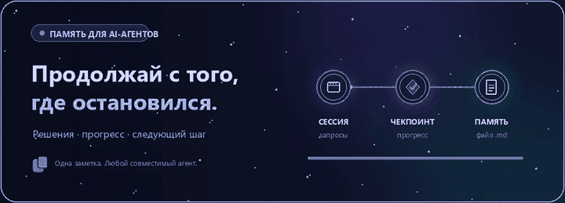

<div align="center">


<br>

**Сохраняй контекст. Продолжай с того же места.**

[](https://agentskills.io/specification)
[](https://www.markdownguide.org/)
[](LICENSE)

[Установка](#-установка) · [Как работает](#-как-это-работает) · [Совместимость](#-совместимость) · [Безопасность](#-точность-и-приватность)

</div>

---

## ✦ Что такое Memory Upgrade?

**Memory Upgrade** — переносимый навык для AI-агентов, который помогает сохранять рабочий контекст проекта между сессиями.

Вместо того чтобы каждый раз заново объяснять агенту архитектуру, принятые решения и текущий прогресс, он ведёт компактный файл **`SESSION_MEMORY.md`** прямо в корне проекта.

> Не стенограмма диалога, а рабочая память: что делаем, что уже сделано, почему выбрали именно это и какой следующий шаг.

## ⟡ Что сохраняется

<table>
<tr>
<td width="50%" valign="top">

### 🎯 Контекст задачи
- Цель и текущий статус
- Требования и ограничения
- Уточнения пользователя

</td>
<td width="50%" valign="top">

### 🧠 Решения
- Принятые технические решения
- Причины выбора
- Важные изменения требований

</td>
</tr>
<tr>
<td width="50%" valign="top">

### ⚡ Ход работы
- Выполненные действия
- Изменённые файлы
- Результаты проверок

</td>
<td width="50%" valign="top">

### ➜ Продолжение
- Незакрытые задачи
- Блокеры и вопросы
- Ближайший конкретный шаг

</td>
</tr>
</table>

## ↻ Как это работает

<div align="center">
  
</div>

| Этап | Действие агента |
|:--:|---|
| **01 · RESTORE** | Находит и читает `SESSION_MEMORY.md`, сверяет заметки с реальным состоянием проекта. |
| **02 · WORK** | Выполняет задачу и фиксирует важные запросы, решения, действия и результаты. |
| **03 · CHECKPOINT** | Перед паузой или передачей работы обновляет статус и следующий шаг. |
| **04 · CONTINUE** | Следующая сессия восстанавливает контекст и продолжает работу с актуального состояния. |

## 🚀 Установка

### Через GitHub CLI

Установите навык для нужных агентных сред:

```bash
gh skill install Pre11yhacker/memory-upgrade memory-upgrade \
  --agent codex \
  --agent claude-code \
  --agent cursor \
  --agent github-copilot \
  --agent opencode \
  --scope user
```

Уберите ненужные параметры `--agent`. Для установки только в текущий репозиторий используйте `--scope project`.

Документация: [GitHub CLI — gh skill install](https://cli.github.com/manual/gh_skill_install).

### Автоматическое применение в проекте

Чтобы агент применял правила на протяжении проектной работы:

1. Скопируйте [`skills/memory-upgrade/AGENTS.md`](skills/memory-upgrade/AGENTS.md) в корень проекта.
2. Объедините его с существующим `AGENTS.md` — не перезаписывайте проектные инструкции.
3. Если среда использует другой файл постоянно загружаемых правил, перенесите туда ту же краткую инструкцию.

Полный алгоритм находится в [`SKILL.md`](skills/memory-upgrade/SKILL.md).

## 🧩 Совместимость

Навык использует переносимый формат **Agent Skills**. Его можно подключать к совместимым агентным системам; конкретный способ обнаружения и загрузки зависит от среды.

| Среда | Поддержка / подключение |
|---|---|
| Codex | Через GitHub CLI или совместимый каталог навыков |
| Claude Code | Через GitHub CLI или совместимый каталог навыков |
| Cursor | Через GitHub CLI; для постоянных правил — `AGENTS.md` / правила проекта |
| GitHub Copilot | Через GitHub CLI |
| OpenCode | Через GitHub CLI или каталог навыков OpenCode |
| Другие агенты | Если поддерживают формат Agent Skills или проектные инструкции |

Полезные ссылки: [Agent Skills specification](https://agentskills.io/specification) · [OpenCode Skills](https://opencode.ai/docs/skills/) · [Cursor Rules](https://docs.cursor.com/context/rules-for-ai).

## 🛡️ Точность и приватность

- **Проверяй факты.** Состояние файлов и рабочего пространства важнее старой заметки.
- **Разделяй факт и предположение.** Не отмечай проверки как выполненные, если они не запускались.
- **Не выдумывай историю.** Если прошлый контекст неизвестен, так и укажи.
- **Не сохраняй секреты.** Пароли, токены, приватные ключи и посторонние личные данные не должны попадать в память.
- **Контролируй Git.** Реши, стоит ли коммитить `SESSION_MEMORY.md`: файл может содержать внутренний ход работы проекта.

<details>
<summary><strong>Важное ограничение</strong></summary>

Memory Upgrade — это **не фоновый демон и не отдельный сервис**. Чекпоинты записывает активный агент в процессе своей работы. Навык не наблюдает за неактивной сессией и не сохраняет дословно каждый токен диалога.

</details>

## 📁 Структура проекта

```text
memory-upgrade/
├── AGENTS.md
├── README.md
├── assets/
│   ├── memory-upgrade-banner.svg
│   └── memory-upgrade-hero.gif
└── skills/
    └── memory-upgrade/
        ├── AGENTS.md
        ├── SKILL.md
        └── templates/
            └── SESSION_MEMORY.md
```

## 🤝 Вклад

Нашёл проблему или хочешь улучшить workflow? Создай [Issue](../../issues) или Pull Request.

При сообщении о проблеме с установкой укажи:
- агентную среду и её версию;
- способ установки;
- ожидаемое и фактическое поведение.

---

<div align="center">

**Memory Upgrade** · Built for workflows that outlive a context window.

<sub>Keep the work. Keep the decisions. Keep moving.</sub>

</div>
